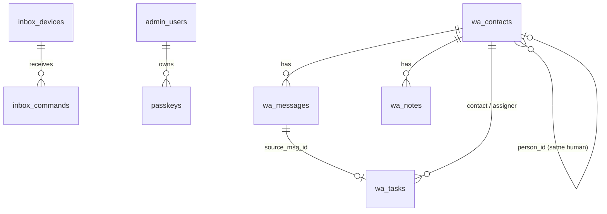

# SUMON VA — System Knowledge (primary technical reference)

| Field | Value |
|---|---|
| Version | 1.0 (2026-11-07) |
| Directive | `COMPLETE SYSTEM UNDERSTANDING.md`, within the limits of `Brain_Prompt.md` v2.0 and `docs/PROJECT_RULES.md` |
| Repo state audited | branch `feature/va-server-2026-11-06`, HEAD `bcff375`, working tree clean except the untracked directive file |
| Method | repository reading + `grep` inventories + local test runs. **No phone, emulator, adb, build, database or live-server access in this audit.** |
| Evidence labels | SOURCE = read in code · TEST = local test run today · CONFIG = config/manifest read · DOC = taken from an earlier project doc, not re-checked today · NOT RUNTIME VERIFIED = nothing ran on a device or the live server today |

This file does not repeat what the existing docs already record well. Where a topic is covered elsewhere, the section links to it. Read with: `docs/START_HERE.md`, `docs/HANDOFF.md` §0, `docs/REMAINING_WORK.md`, `docs/AUDIT_2026-11-06.md`, `docs/BRAIN_DELIVERABLES.md`.

---

## 1. Identity and purpose
A private, single-owner Android app ("সুমনের ভার্চুয়াল সহকারী", package `com.masumon.sumonva`) plus its own FastAPI server. The phone reads chat-app notifications, SMS and calls and relays them to the server. The server (rules first, AI second) decides what to do: notify, draft, ask for approval, or send under explicit owner rules. It also tracks tasks, commitments, identity and memory. The owner is non-technical and works in Bangla. Never for sale or publication. (DOC: `docs/PROJECT_CHARTER.md` §1, memory note on purpose.)

## 2. Architecture at a glance
```mermaid
flowchart LR
  subgraph Phone["Android phone (Expo 57 / RN 0.86 + Kotlin va-bridge)"]
    NL[VaNotificationListener] --> Q[(Encrypted outbox ≤500)]
    SMS[SmsReceiver] --> Q
    CALL[CallReceiver] --> Q
    Q --> PS[PollService (foreground)]
    UI[routes/*.tsx] -->|native request(), path allow-list| PS
  end
  PS -->|POST /device/ingest, GET /device/poll (long-poll), POST /device/ack| API
  subgraph Server["Render 'sumon-va-api' (FastAPI, Python 3.11)"]
    API[/api/v1 routers/] --> FLOW[assistant/wa_flow._process]
    FLOW --> BRAIN[wa_brain rules · call_context · thread_state · assignments · identity · memory · f0]
    BRAIN --> AI[ai_hub → Gemini/Groq/OpenRouter/Mistral/OpenAI-compatible]
    SCHED[core/scheduler.py 1-min loop → wa_flow.run_cron] --> FLOW
    FLOW --> ALERT[channels/alerts.push_owner]
  end
  API --> DB[(Supabase 'Sumon_va' Postgres, 14 tables, RLS on)]
  ALERT --> TG[Telegram @SumonVA_bot]
  ALERT -->|alert command| PS
  TG -->|/telegram/webhook| API
  CF[Cloudflare Email Worker] -->|/email/inbound| API
  ABO[ABO admin tab] -->|HMAC /integration/*| API
```

## 3. Repository map (active vs not)
| Path | Role | Status |
|---|---|---|
| `routes/` | expo-router screens (root = `routes`, set in `app.json`) | active, 24 screens + `m/[key].tsx` |
| `src/va/` | app logic: `api.ts` (server wrapper), `config.ts` (`SERVER = https://va-api.aboenterprise.com`), Page, Drawer, menu, health, permissions | active |
| `src/ui/`, `src/theme/` | shared UI kit and tokens (`theme/index.ts`, `designs.ts`) | active |
| `src/app/` | `AppProviders`, `AppPreferences` (theme, language, screenshot block) | active |
| `src/database/`, `src/services/db-*`, `src/backup/crypto.ts` | local SQLite for preferences, lock and error log | active (DOC: HANDOFF §3b says not dead) |
| `modules/va-bridge/` | Kotlin native module: `VaBridgeModule.kt`, `Core.kt`, `Receivers.kt`, `PollService.kt`, `ChatOpener.kt`, `PasskeyHelper.kt` | active |
| `android/` | generated native project, manifest, signing (keystore not in git) | active |
| `server/app/api/v1/routes/` | routers | 6 mounted, `auth.py` and `passkeys.py` NOT mounted (helper code only) |
| `server/app/assistant/` | Brain and channels | active, except the WhatsApp Cloud API files kept unused by owner decision |
| `server/app/models/models.py` | ORM | holds ~49 ABO shop tables that do NOT exist in `Sumon_va` (only `admin_users`, `settings`, `activity_logs`, `notifications`, `system_events`, `email_templates`, `passkeys` exist) |
| `server/manual_sql/` | `0001` schema (14 tables), `0002`, `0003` (+ rollback files) | all run by the owner (DOC) |
| `server/tests/` | 29 pytest files | active |
| `tools/` | `build-apk.ps1`, `ship.ps1`, icon/logo/keystore scripts | active |
| `docs/` | project knowledge (see `SUMON_VA_DOCUMENTATION_INDEX.md`) | active |
| `_private/`, `sumon-va-audit-*`, `sumon-va-design-*` | private previews | ignored only by `.git/info/exclude`, NOT by `.gitignore` (see §12, R-08) |

## 4. Technology stack (CONFIG)
App: Expo ~57.0.16, React Native 0.86.2, React 19.2.3, expo-router 57, zustand 5, expo-sqlite, Reanimated 4.5, TypeScript ~6.0. Native: Kotlin, `androidx.security.crypto` (EncryptedSharedPreferences + MasterKey AES256_GCM). Server: FastAPI 0.115, SQLAlchemy 2.0 async + asyncpg, Pydantic 2.10, `python-jose`, `bcrypt`, `webauthn` 2.2, httpx. Infra (DOC): Render free (sleeps after 15 min idle), Supabase free (no automatic backup), Cloudflare DNS + Email Worker, Telegram bot. Several server requirements are ABO leftovers with no Sumon VA use (`cloudinary`, `reportlab`, `fpdf2`, `resend`, `pywebpush`, `openpyxl`, `deep-translator`); not verified one by one.

## 5. Android application
### 5.1 Startup
`index.js` → `routes/_layout.tsx` (expo-router `Stack`, `Drawer`, `PrimaryNav` bottom bar on `/`, `/inbox`, `/tasks`, `/more`) → providers (`src/app/AppProviders.tsx`, `AppPreferences.tsx`) → `LockGate` (PIN 4–8 digits + biometric). (SOURCE, partial read.)
### 5.2 Native components (CONFIG: `modules/va-bridge/android/src/main/AndroidManifest.xml`)
| Component | Trigger | Sends to | Exported / guard |
|---|---|---|---|
| `VaNotificationListener` (service) | any posted/removed notification of watched apps | outbox → `/device/ingest` (`type=seen` on removal) | exported, `BIND_NOTIFICATION_LISTENER_SERVICE` |
| `PollService` (foreground, `remoteMessaging|dataSync`) | app start, boot, listener | long-poll `/device/poll`, `/device/ack`, uploads outbox | not exported |
| `SmsReceiver` | `SMS_RECEIVED` | outbox | exported, `BROADCAST_SMS` |
| `CallReceiver` | `PHONE_STATE` | outbox (missed call) | **exported, no sender permission** |
| `SmsStatusReceiver` | sent/delivered PendingIntents | `/device/ack` result | not exported |
| `BootReceiver` | `BOOT_COMPLETED` | restarts `PollService` | exported, no permission (normal for boot) |
| `GuardAdmin` | device-admin enable/disable | Telegram warning via server | `BIND_DEVICE_ADMIN` |
Token: only in `Core.Store` (Keystore-backed EncryptedSharedPreferences); never handed to JS. Unreadable file after a restore → wiped, app shows "not paired" (`Core.kt:32-33`). Outbox max 500, oldest dropped (`Core.kt:119,133`). HTTP: connect 15 s, read up to 75 s (`Core.kt:97-99`). JS can call the server only through `request()` with an allow-list of path prefixes (DOC: `SERVER_SEPARATION_MASTER_PLAN.md` §3.2, `AUDIT` §5).
### 5.3 Permissions (CONFIG)
Module manifest: INTERNET, RECEIVE_SMS, SEND_SMS, **READ_SMS** (added after owner approval, 2026-11-06), READ_PHONE_STATE, READ_CALL_LOG, FOREGROUND_SERVICE (+DATA_SYNC, +REMOTE_MESSAGING), USE_FULL_SCREEN_INTENT, VIBRATE, ACTIVITY_RECOGNITION, WAKE_LOCK, ACCESS_NOTIFICATION_POLICY, RECEIVE_BOOT_COMPLETED, POST_NOTIFICATIONS, ACCESS_NETWORK_STATE. App manifest adds: ACCESS_COARSE/FINE_LOCATION, READ_CONTACTS, REQUEST_IGNORE_BATTERY_OPTIMIZATIONS, USE_BIOMETRIC; removes CAMERA and WRITE_EXTERNAL_STORAGE. Special access: notification listener, battery exemption, full-screen intent (must be granted by hand on Android 14/15; seen refused on the phone, DOC), device admin. Runtime grant state today: NOT RUNTIME VERIFIED. Full matrix with purposes: `docs/BRAIN_DELIVERABLES.md` §4 (note: that table predates READ_SMS).
### 5.4 Behaviour scenarios (code-level; NOT RUNTIME VERIFIED today)
| Scenario | Expected from code / docs |
|---|---|
| App open / background | foreground `PollService` keeps syncing; JS polling pauses in background (DOC) |
| Swiped from recents | foreground service survives on stock Android; OEM (vivo) may kill it: platform limited |
| Force-stop | nothing runs until the app is opened (platform) |
| Reboot | `BootReceiver` restarts the service; earlier measured ~2.5 min delay (DOC, charter §3) |
| No internet | items wait in the encrypted outbox (≤500); oldest dropped beyond that |
| Internet restored | outbox uploads one by one; only 400/413/422 drop an item (DOC S-02) |
| Notification dismissed | `seen` hint only, labelled "not proof of reading" |
| Reply into WhatsApp etc. | only via the live notification's RemoteInput; impossible after the notification is gone (platform) |
| Owner replies by hand in another app | not observable; "আমি নিজে উত্তর দিয়েছি" button is the alternative |
| Sign-out | unsent outbox is lost silently (DOC AUDIT §6) |
| App update | in-place `adb install -r` keeps the token (DOC) |

## 6. Frontend
Screens (`routes/`): `index` (home), `inbox`, `contact`, `tasks`, `f0` (Sitting Room / command centre, owner decision), `alerts`, `rules`, `routine`, `settings`, `ai` (AI connections, not the Brain), `channels`, `health`, `wa-health`, `report`, `scripts`, `simulate`, `setup`, `lock-setup`, `login`, `pair`, `tour`, `about`, `more`, `m/[key]` (per-platform module page). Per-screen findings already recorded: `docs/AUDIT_2026-11-06.md` §7–§9. Design reality: the app renders the "aurora" theme (`AppPreferences.tsx` → `designs.ts`), not the approved "Sapphire & Gold, no shadows" of `DESIGN.md` (DOC AUDIT §1; owner later decided "keep design, polish only"). No list uses `FlatList`. No frontend unit tests exist (no `*.test.*` / `__tests__` in `src`, `routes`, `modules`).

## 7. Backend
### 7.1 Request path
`server/app/main.py`: lifespan → optional `bootstrap_admin` → `schema_guard.ensure_admin_security_columns` + `ensure_wa_tables` (additive) → `core/scheduler.start()` only when `APP_ENV=production` (1-minute loop calling `wa_flow.run_cron`). Middleware: CORS, `protect_assistant_audit_logs`, security headers (CSP `default-src 'none'`, HSTS on https). Errors: `ABOException` → JSON; anything else → 500 "Internal server error" (detail only in DEBUG). `/docs` only in DEBUG. `/` returns `APP_NAME` (DOC: still says "ABO Enterprise API" unless the env var is set).
### 7.2 Auth dependencies (SOURCE)
`current_device` (device `dvc_` token), `owner_or_device(permission)` (`core/device_auth.py:55`; owner JWT OR device token), `require_admin` / `require_role` (`core/security.py:286,337`; owner JWT only), `service_auth` (HMAC, `/integration/*`), `rate_limit(...)`. **This server never issues an owner JWT** (`auth.py` not mounted), so `require_admin`/`require_role` routes cannot be used from the app (DOC AUDIT §5, consistent with SOURCE).
### 7.3 API inventory (SOURCE, counted today)
102 endpoints under `/api/v1` + `/` + `/.well-known/assetlinks.json`.
| Router (prefix) | Count | Auth mostly | Consumer |
|---|---|---|---|
| `inbox.py` (none) | 30 | device / owner_or_device; public pair/login/otp/passkey with rate limits; webhook secret | app + native |
| `wa_assistant.py` (none) | 47 | `owner_or_device` (42 uses), `require_role` (6) | app |
| `ai_hub.py` (none) | 9 | `owner_or_device` | app (`routes/ai.tsx`) |
| `ai_catalog.py` (`/admin/ai-catalog`) | 10 | `require_admin` | **none** (ABO shop code; queries `Product`/`Service` tables that do not exist in this DB) |
| `integration.py` (`/integration`) | 3 | `service_auth` HMAC | ABO admin tab |
| `health.py` | 3 | public | uptime checks |
Contract check (script, today): every server path the app or Kotlin uses exists on the server (0 mismatches). Server routes with no app consumer: all 10 `ai-catalog` routes; `/admin/inbox/{pair-code, devices/{id}, telegram/connect}` and `/admin/wa/{ask, config/reset, events, messages/{id}/feedback, setup, webhook/connect}` (admin-only or unused); `/device/passkey/list`, `DELETE /device/passkey/{id}`; machine endpoints `/telegram/webhook`, `/email/inbound`, `/email/cron`, `/wa/cron`, `/ai-hub/cron`, `/health*`, `/integration/*`. Full per-route table: run the decorator grep in §13; route-by-route request/response schemas are NOT documented here (gap, see §14).

## 8. Database (SOURCE: `server/manual_sql/`)
14 tables from `0001`: `admin_users`, `passkeys`, `settings`, `activity_logs`, `notifications`, `system_events`, `email_templates`, `wa_contacts`, `wa_messages`, `wa_notes`, `wa_tasks`, `inbox_devices`, `inbox_pair_codes`, `inbox_commands`. `0002`: `wa_contacts.person_id UUID` + partial index. `0003`: 7 nullable columns on `wa_tasks` (`status`, `progress`, `blocker`, `source_msg_id`, `confidence`, `assigner_contact_id`, `updated_at`). RLS is ENABLED on all 14 tables in the SQL file and **no policies are defined**: only the server's direct DB role can read or write (correct for a server-only design). **Live RLS VERIFIED 2026-11-07** (owner ran the read-only query: all 14 tables `rls_on = true`, 0 policies). `person_id` and the `0003` columns are deliberately NOT mapped in the ORM (Core reference + SAVEPOINT probe), so old deploys never break (DOC rule). Sensitive data: `wa_messages` (message text; private chats sealed `enc1:`), `wa_contacts` (phones, names), `inbox_devices` (token hashes), `settings` (AI keys encrypted with Fernet from `SECRET_KEY`, DOC).

(Relationships drawn from column names; FK constraints not re-checked line by line today.)

## 9. Brain / AI (pointer)
Pipeline: ingest (`channels/ingest.py`: OTP mask, dedupe, spam `promo.py`) → `wa_flow._process` (identity + names → call context → thread state / grouping gate → assignments / promises → rules `wa_brain` + `guard_text` → decision `explain_mode`) → draft / auto-send under rules → `alerts.push_owner` (Telegram + phone alarm) → `run_cron` (sweep stuck messages, task and unanswered reminders, held-alert digest, purge). AI only interprets; private/family text never goes to AI; numbers/emails masked before AI. Full module table, 18-domain status and limits: `docs/BRAIN_DELIVERABLES.md` §1–§2, §6 and `docs/BRAIN_MASTER_PLAN.md` §1. The separate 18-domain functional audit is NOT part of this document.

## 10. External integrations
| Integration | Auth (names only) | Status |
|---|---|---|
| Telegram bot | `TELEGRAM_*` env + webhook secret header | webhook rejects bad secret (DOC, live 403); enabled state not verified |
| Email in (Cloudflare Worker) | `EMAIL_INBOUND_SECRET` | server part present; worker live state not verified; no reply path |
| AI providers | owner keys stored encrypted in `settings` | 4 connections working on the phone (DOC); quotas not permanent |
| ABO admin tab | `VA_INTEGRATION_TOKEN` HMAC | owner-verified (DOC) |
| ABO summary API | `ABO_API_BASE`, `ABO_INTEGRATION_TOKEN` | not built on the ABO side; spec in `docs/ABO_SUMMARY_API_SPEC.md` |
| WhatsApp Cloud API | — | dropped by owner decision; files kept unused |
| Google passkey | WebAuthn, `assetlinks.json` | not tested on the new host |

## 11. Tests run today (2026-11-07)
| Command | Result |
|---|---|
| `cd server; python -m pytest -q` | **454 passed**, 0 failed, 32 warnings (mostly `datetime.utcnow` deprecation), 10.1 s |
| `npx tsc --noEmit` | no errors |
| `npx eslint routes src modules` | no errors |
| Frontend unit tests | none exist |
| Kotlin compile / APK / device | **not run** (forbidden in this audit; a build was running on the owner's PC) |
The docs still say 421 or 436 server tests; 454 is today's real number.

## 12. Issues found or re-confirmed in this audit
New in this audit (SOURCE / CONFIG):
| ID | Sev | Finding | Evidence |
|---|---|---|---|
| R-01 | P2 | `ai_catalog` router (10 routes) is mounted but is ABO shop code; it queries `Product`/`Service` ORM tables that do not exist in `Sumon_va` → would error if called. Admin-JWT-only, and no JWT is issued, so not reachable today | `api/v1/router.py:7`, `routes/ai_catalog.py:265` |
| R-02 | P3 | `models/models.py` carries ~49 ABO tables absent from the DB; any future import of them fails at query time | `models/models.py` |
| R-03 | P2 | `CallReceiver` exported with no sender permission: another app could forge `PHONE_STATE` broadcasts and create fake missed-call alerts (old item F-08, still open) | module manifest line 55 |
| R-04 | P2 | `allowBackup="true"`. Token file is excluded by the backup rules (DOC F-01), so the risk is other app data in cloud backup; not re-checked | app manifest |
| R-05 | P3 | Docs show stale test counts (367/421/436 vs 454 today) | §11 |
| R-06 | P3 | `BRAIN_DELIVERABLES.md` §4 says READ_SMS "not added", but it is now declared (owner approved) | module manifest line 5 |
| R-07 | P3 | Server requirements include ABO-only packages (larger image, more CVE surface) | `server/requirements.txt` |
| R-08 | P2 | Private folders are kept out of git only by `.git/info/exclude` (local to this PC). A fresh clone or another PC would not ignore them, yet the docs say "all in .gitignore" | `.gitignore`, `.git/info/exclude` |
Still open from earlier audits (DOC, not re-verified today): urgent alert reached the phone but did not ring (channel `va_normal_v2`); screenshot block not working on the phone; live RLS check; no automatic DB backup; Telegram sign-in prompt spam (12/hour); `CF-Connecting-IP` trust when Render is reached directly; health "all OK" honesty; outbox lost on sign-out; touch targets < 48 dp; contrast; no `FlatList`. Ranked list: `docs/AUDIT_2026-11-06.md` §10, `docs/REMAINING_WORK.md` §০০.

## 13. Development and maintenance
Commands: `cd server; python -m pytest` · `npx tsc --noEmit` · `npx eslint routes src modules` · Kotlin compile only: `cd android; .\gradlew.bat :va-bridge:compileDebugKotlin --offline --max-workers=1` · build (owner's OK first): `powershell -ExecutionPolicy Bypass -File tools\build-apk.ps1 -Target phone`. Route inventory: `grep -nE '^@router\.(get|post|put|patch|delete)\(' server/app/api/v1/routes/*.py`. Rules you cannot break: `docs/PROJECT_RULES.md` (owner approves every task, build, push, merge, deploy and SQL; one SQL at a time: Preflight → Execution → Verification; no secrets; no `Co-Authored-By` lines; family never auto-replied; imported messages never processed; unrun-SQL columns never mapped in the ORM; no sub-agents unless the owner asks).

## 14. Unverified areas and open questions
- Nothing in this document was checked on the phone, the emulator or the live server.
- Per-endpoint request/response schemas, and the FK constraints in `0001`, were not documented line by line.
- Screen-by-screen state/flow tables (directive §5.2) exist only partly (`AUDIT` §7). A full per-screen pass needs another session.
- Live RLS, live env values, Telegram/email enabled state, AI quotas: need the owner's read-only checks.
- Android scenarios in §5.4 are code-level only; battery, CPU and OEM killing have not been measured on the current build.

## Update history
| Date | Version | Change |
|---|---|---|
| 2026-11-07 | 1.0 | First version from the COMPLETE SYSTEM UNDERSTANDING directive (read-only audit, no code change) |
| 2026-11-07 | 1.1 | 18-domain work: new `assistant/obligations.py` (official notices + invitations), `official_words`/`invite_words` config, `decide` never answers official matters (p ≤ 2), dated ones → proposed task; `.gitignore` private folders (R-08 fixed); `APP_NAME` default "Sumon VA API"; tests now **466 passed**. Details: `SUMON_VA_18_DOMAIN_*.md` |
| 2026-11-07 | 1.2 | Second round: Cloud API routes and app screen removed, `ai_catalog` unmounted (API now 88 endpoints under /api/v1 + 2), app daily summary real, deadline priority, name masking in owner AI questions, native FLAG_SECURE, call-log-verified missed calls, sign-out warning. Server tests 468. See `SUMON_VA_18_DOMAIN_IMPLEMENTATION_REPORT.md` §5 |
