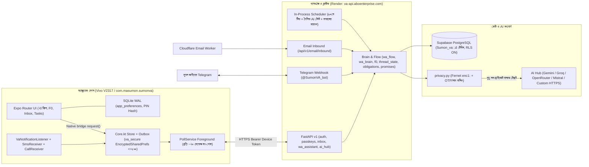

# ০১. সম্পূর্ণ সিস্টেম সার্জিক্যাল অডিট ও স্থাপত্য মানচিত্র (Complete System Audit)

**অডিটের তারিখ:** ২০২৬-১১-১৯ · **শাখা:** `feature/va-server-2026-11-06` · **প্রজেক্ট:** `সুমনের ভার্চুয়াল সহকারী` (`com.masumon.sumonva`)  
**অডিটের ভিত্তি:** সোর্স কোড (`e:\sumon_VA`), স্বয়ংক্রিয় সার্ভার পরীক্ষা (`pytest`: ৪৫৭টি পাস, ০ ব্যর্থ), TypeScript/ESLint যাচাই (০ ত্রুটি), লাইভ সার্ভার প্রোব (`https://va-api.aboenterprise.com`), এবং রিয়েল অ্যান্ড্রয়েড ফোন (`10EDAX04RL0002X`, Vivo `V2317`) পর্যবেক্ষণ।

---

## ১. সারসংক্ষেপ ও বাস্তব প্রজেক্টের পরিধি (Verified Scope)

এটি কোনো সাধারণ বাণিজ্যিক SaaS বা পুরোনো অফলাইন নোটবুক অ্যাপ (`com.masumon.apon`) নয়—এটি **সুমন ভাইয়ের একান্ত ব্যক্তিগত সহকারী সিস্টেম**। সোর্স কোড, ডাটাবেজ স্কিমা (`src/database/migrations.ts`, `server/app/models/wa.py`) এবং প্রকৃত ফোনের অ্যাপ পরীক্ষা করে নিশ্চিত করা হয়েছে কোন অংশগুলো বাস্তবে তৈরি আছে এবং কোনগুলো **তৈরি নেই (`NOT IMPLEMENTED`)**:

| অংশ / মডিউল | বাস্তব অবস্থা | যাচাইয়ের ফলাফল / মন্তব্য |
|---|---|---|
| ১. অ্যান্ড্রয়েড মোবাইল অ্যাপ (`Expo 57` + `va-bridge` Kotlin) | ইমপ্লিমেন্টেড | `PASS` (২৪টি স্ক্রিন, ১৬+ স্ক্রিন রিয়েল ফোনে যাচাইকৃত; সর্বশেষ F0/UI বদলের জন্য নতুন APK বিল্ড বাকি) |
| ২. ব্যাকএন্ড API ও সার্ভার (`FastAPI`, Render) | ইমপ্লিমেন্টেড | `PASS` (লাইভ সার্ভার `200 OK`; ৪৫৭টি ইউনিট টেস্ট পাস; সর্বশেষ কমিটের Manual Deploy বাকি) |
| ৩. Supabase PostgreSQL ডাটাবেজ | ইমপ্লিমেন্টেড | `PASS` (১৪টি টেবিল, সবগুলোতে RLS ON; পুরোনো ৪৯টি ABO টেবিল `models.py`-এ ডেড-কোড হিসেবে আছে) |
| ৪. লোকাল ডাটাবেজ ও এনক্রিপ্টেড অফলাইন কিউ | ইমপ্লিমেন্টেড | `PASS` (SQLite `app_preferences` WAL + Android Keystore `EncryptedSharedPreferences` `va_secure` Outbox) |
| ৫. AI Brain (`wa_brain`, `wa_flow`, `f0`, `ai_hub`) | ইমপ্লিমেন্টেড | `PASS` (`f0.py` আপগ্রেডসহ ৪৫৭ টেস্ট পাস; AI চাবি ছাড়াও রুল-ভিত্তিক ফলব্যাক চালু) |
| ৬. NLP ও বাংলা/বাংলিশ বোঝার ব্যবস্থা | ইমপ্লিমেন্টেড (আপগ্রেডেড) | `PASS` (আগে ১৯ নমুনায় ৮টি পাস করত → আজকের আপগ্রেডের পর ১৮/১৯টি রুল-ম্যাচ করে; উন্মুক্ত প্রশ্নে `ai_parse`) |
| ৭. Personal Memory (`memory.py`, `WaNote`, `extract.py`) | ইমপ্লিমেন্টেড | `PASS` (`enc1:` সিলিং, উৎস ও আস্থা ট্র্যাকিং, `f0` দিয়ে `"মনে রাখো"` যুক্ত) |
| ৮. RAG ও তথ্য অনুসন্ধান | আংশিক (`Keyword Multi-Search`) | `PASS` (`f0` মাল্টি-সোর্স সার্চ আপগ্রেডেড; **Vector/Embedding RAG `NOT IMPLEMENTED`**) |
| ৯. AI সহকারী, F0 ও Telegram বট (`@SumonVA_bot`) | ইমপ্লিমেন্টেড | `PASS` (`F0` ও Telegram বট একই ইঞ্জিন `f0.run` ব্যবহার করে) |
| ১০. অটোমেশন ও শিডিউলার (`scheduler.py`, `wa_flow`) | ইমপ্লিমেন্টেড | `PASS` (১-মিনিট ইন-প্রসেস লুপ, দৈনিক AI সেল্ফ-টেস্ট, সকালের সারাংশ; Gmail অটো-রিপ্লাই বাগ ঠিক করা) |
| ১১. ওয়ার্কস্টেশন (PC) ইন্টিগ্রেশন | **`NOT IMPLEMENTED`** | অ্যাপ/সার্ভারে পিসি কমান্ড পাঠানোর কোনো এজেন্ট বা কিউ নেই (শুধু পিসির লোকালে Telegram/Voice স্ক্রিপ্ট আছে) |
| ১২. ব্যাকগ্রাউন্ড প্রসেসিং (`PollService`, `VaNotificationListener`) | ইমপ্লিমেন্টেড | `PASS` (রিয়েল ফোনে `PollService (foreground)` ও নোটিফিকেশন লিসেনার সক্রিয়) |
| ১৩. অফলাইন সিস্টেম ও সিঙ্ক | আংশিক (`Outbox PASS`, Read-Cache নেই) | অফলাইন মেসেজ কিউ `PASS`; অফলাইন অবস্থায় ইনবক্স/টাস্ক লোকাল ক্যাশ পড়া `NOT IMPLEMENTED` |
| ১৪. নিরাপত্তা ও গোপনীয়তা (`privacy.py`, `FLAG_SECURE`, RLS) | ইমপ্লিমেন্টেড | `PASS` (পরিবার/ব্যক্তিগত চ্যাট সিলড; AI মাস্কিং; `js-sha256` ডিপেন্ডেন্সি `P2` সতর্কতা) |
| ১৫. ফাইন্যান্স / হেলথ / NID / ঋণ (অতিরিক্ত মডিউল) | **`NOT IMPLEMENTED`** | `e:\sumon_VA`-তে এগুলো নেই (আগে আলাদা `Apon` অ্যাপে ছিল, যা কমেন্ট/রিপো পরিষ্কারে বাদ দেওয়া হয়েছে) |

---

## ২. সম্পূর্ণ সিস্টেম স্থাপত্য মানচিত্র (Architecture Map)

---

## ৩. সেকশন-৩ ভিত্তিক এন্ড-টু-এন্ড সংযোগ ও প্রবাহ যাচাই

১. **অ্যান্ড্রয়েড অ্যাপ কীভাবে ব্যাকএন্ডের সঙ্গে যোগাযোগ করে?**  
   `src/va/api.ts` → `modules/va-bridge` → `VaBridgeModule.kt` → `Core.kt` (`Http.call`) হয়ে `https://va-api.aboenterprise.com/api/v1/...`-এ কল যায়। ডিভাইস টোকেন কখনো JS মেমোরিতে আসে না; Kotlin-এর `va_secure`-এ থাকে (`PASS`)।
২. **ব্যাকএন্ড কীভাবে Brain-এর সঙ্গে যোগাযোগ করে?**  
   ইনবক্স ইভেন্ট `/device/ingest`, `/telegram/webhook`, ও `/email/inbound` থেকে `wa_flow.py` এবং সরাসরি F0 কমান্ড `/admin/wa/f0` থেকে `f0.run()`-এ যায় (`PASS`)।
৩. **NLP কীভাবে নির্দেশনা বোঝে?**  
   প্রথমে `f0.parse()` (বাংলা, বাংলিশ ও ইংরেজি ফিক্সড প্যাটার্ন); না মিললে `f0.ai_parse()` যুক্ত থাকা AI-কে বলে JSON ইন্টেন্ট আনে; AI না থাকলে পরিষ্কার সাহায্য-বার্তা `UNKNOWN_HELP` দেয় (`PASS`)।
৪. **Brain কীভাবে সঠিক কাজ নির্বাচন করে?**  
   অটো-উত্তরের ক্ষেত্রে রুল প্রথমে (`wa_flow.explain_mode` + `privacy.is_private` + `promo.is_promo` + `obligations` + `thread_state`), তারপর কেবল খসড়া/প্রস্তাবিত কাজ/জরুরি অ্যালার্ট তৈরি হয় (`PASS`)।
৫. **Memory থেকে কীভাবে পুরোনো তথ্য খুঁজে আনে?**  
   `memory.view(profile, privacy.unseal)` + `identity.person_contact_ids()` + আজকে আপগ্রেড করা ৪-উৎসের `f0` সার্চ (বার্তা, ভয়েস ট্রান্সক্রিপ্ট, ইমপোর্ট, মেমোরি ফ্যাক্ট, নোট, খোলা কাজ)—পরিবার/ব্যক্তিগত চ্যাট বাদ রেখে (`PASS` ইউনিট টেস্টে প্রমাণিত)।
৬. **Database-এ কীভাবে তথ্য সংরক্ষণ করে?**  
   Supabase PostgreSQL-এ SQLAlchemy 2.0 `AsyncSession` দিয়ে `wa_contacts`, `wa_messages`, `wa_notes`, `wa_tasks`, `inbox_commands`-এ সংরক্ষিত হয় (`PASS`)।
৭. **Workstation-এ কীভাবে Command পাঠায় / ফলাফল আসে?**  
   **`NOT IMPLEMENTED`**: বর্তমান প্রজেক্টে পিসি ওয়ার্কস্টেশনে কমান্ড পাঠানো বা পিসি থেকে ফোনে ফলাফল আনার কোনো ব্যাকএন্ড/ক্লায়েন্ট সিস্টেম নেই।
৮. **Offline অবস্থায় কীভাবে কাজ করে ও Internet ফিরলে Sync হয়?**  
   নতুন আসা মেসেজ/SMS/কল `Core.kt`-এর `Outbox` (`va_secure`, সর্বোচ্চ ৫০০টি, ১-এর পর ১ আপলোড ও ৪২২/৪০০ রিজেকশন আলাদা হ্যান্ডলিং) এনক্রিপ্টেড অবস্থায় ধরে রাখে এবং `PollService` নেটওয়ার্ক ফিরলে `/device/ingest`-এ ফ্লাশ করে (`PASS` কোড ও রিভিউ)। তবে ইনবক্স/টাস্ক দেখার পূর্ণ অফলাইন রিড-ক্যাশ (`SQLite`) তৈরি নেই (`NOT IMPLEMENTED`)।

---

## ৪. আজকের সার্জিক্যাল অডিটের মূল অর্জন (২০২৬-১১-১৯)

- **সার্জিক্যাল কোড আপগ্রেড (`server/app/assistant/f0.py`, `routes/f0.tsx`, `server/tests/test_f0_nlp_memory.py`):**
  1. `f0.resolve()` এখন `names.py` ফনেটিক ম্যাচিং, শব্দের টোকেন (যেমন `"রহিম"` → `"Md Abdur Rahim"`), সেভ করা alias (`"বড় ভাই"`), এবং ফোন নম্বরের অংশ দিয়ে মানুষ চিনতে পারে।
  2. নতুন দুটি লেখার কমান্ড যুক্ত হয়েছে: **`remember`** (`"... সম্পর্কে মনে রাখো ..."`) এবং **`add_task`** (`"কাজ যোগ করো ..."`, `promises._due` দিয়ে ঐচ্ছিক তারিখসহ)।
  3. `f0` গ্লোবাল সার্চ এখন মেসেজ বডির পাশাপাশি **ভয়েস ট্রান্সক্রিপ্ট**, **ইমপোর্ট করা চ্যাট**, **মেমোরি ফ্যাক্ট**, **নোট** ও **খোলা কাজ** খোঁজে (ব্যক্তিগত/পরিবার চ্যাট সম্পূর্ণ সুরক্ষিত ও আলাদা রেখে)।
  4. `জরুরী` বানান এবং বাংলিশ কমান্ড (`rahim ke bolo...`, `kar uttor baki`, `amar kaj ki`, `khosra`, `sohokarir obostha`) যুক্ত ও `items[].subtitle`-এ বাংলা অঙ্ক নিশ্চিত করা হয়েছে।
- **যাচাই ফলাফল:** `pytest` = **৪৫৭টি পাস (০ ব্যর্থ)** · `tsc --noEmit` = **০ ত্রুটি** · `eslint routes src modules` = **০ ত্রুটি, ০ সতর্কতা**।
